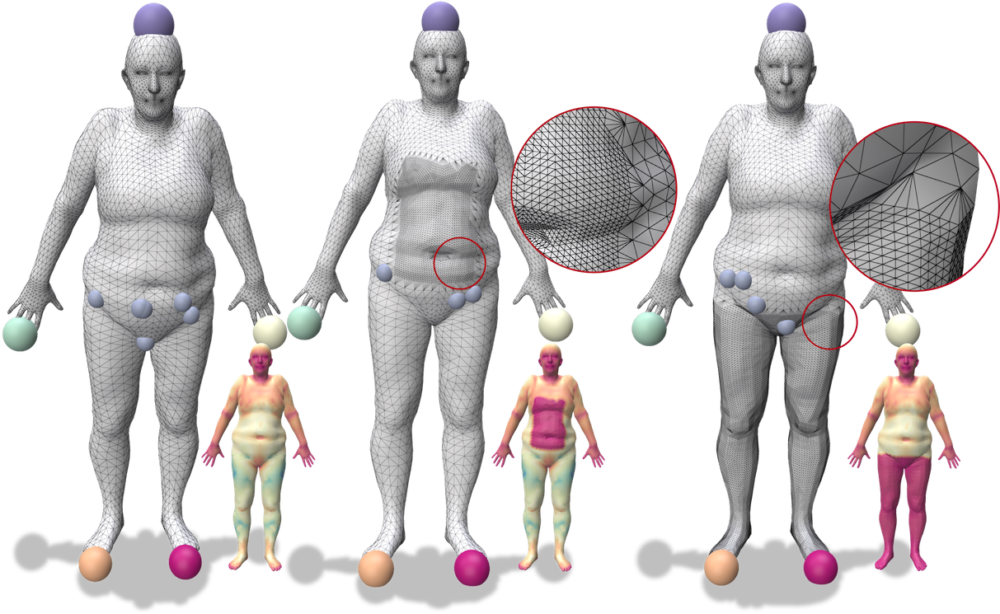

# Non-Rigid-Shape-Correspondence

**Unsupervised Landmark Discovery via Karcher Means for Non-Rigid Shape Correspondence**
**Sample**: Ordering Landmarks on Non-Uniform Mesh Surfaces



This repository contains the official implementation of our method for discovering intrinsic landmarks in 3D shapes for dense correspondence tasks. Our approach computes unsupervised, repeatable, and geometrically meaningful landmarks based on the intrinsic geometry of the surface, enabling robust shape matching without the need for manually labeled annotations.

## 🔍 Overview

Establishing dense shape correspondence across non-rigid 3D surfaces is a long-standing challenge. This project introduces an unsupervised method that:
- Computes intrinsic landmarks using **geometric medians** (Karcher means),
- Selects salient points via **farthest point sampling** over the intrinsic domain,
- Supports matching under **near-isometric deformations**,
- Can be integrated into existing **functional map pipelines**.


## 📁 Project Structure
```text
Non-Rigid-Shape-Correspondence/
├── geometricMedian/     # Karcher mean computation for intrinsic landmark localization
├── logarithmicMap/      # Intrinsic logarithmic map computation on triangle meshes
├── pyFM/                # Functional map pipeline and shape descriptor tools
├── tracinggeodesic/     # Geodesic tracing and shortest path tools
└── README.md            # Project documentation and usage guide
```
## 📖 Citation

If you find this work useful in your research, please cite our paper:

```bibtex
@article{zhang2026landmark,
  author  = {Zhang, Haoliang and Cheng, Samuel and Amm, Christian El},
  title   = {Unsupervised landmark discovery via Karcher means for non-rigid shape correspondence},
  journal = {The Visual Computer},
  volume  = {42},
  number  = {1},
  pages   = {105},
  year    = {2026},
  doi     = {10.1007/s00371-025-04326-5},
  url     = {https://doi.org/10.1007/s00371-025-04326-5}
}
```

## License

This project is licensed under the MIT License. See the [LICENSE](LICENSE) file for details.

